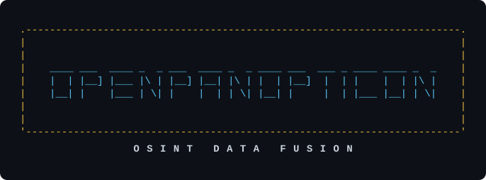
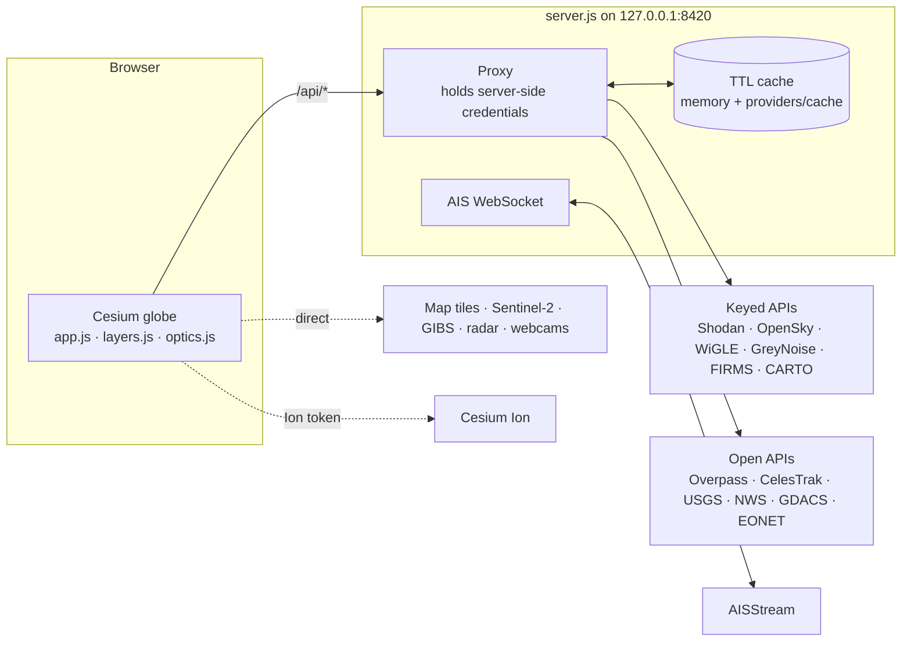

# OpenPanopticon

<div align="center">



[](https://nodejs.org/)
[](LICENSE)
[](package.json)
[](https://cesium.com/platform/cesiumjs/)
[](https://www.youtube.com/watch?v=AVqyvgPxVO8)
[](https://github.com/hexadec-0/OpenPanopticon/actions/workflows/test.yml)

[Run it](#run-it) · [Live demo](https://hexadec-0.github.io/OpenPanopticon/) · [Screenshots](#screenshots-and-demo-video) · [Layers](#whats-on-the-globe) · [Caching](#caching) · [Architecture](#how-its-put-together) · [Responsible use](#using-this-responsibly)

### TRY THE DEMO HERE: <https://hexadec-0.github.io/OpenPanopticon/>

</div>

OpenPanopticon is a geospatial intelligence terminal that runs on your own machine. Point it
anywhere on Earth and it overlays live public data on a 3D globe
(internet-exposed hosts from Shodan, aircraft from OpenSky, satellites
propagated from orbital elements, infrastructure from OpenStreetMap, and
public cameras), then renders the whole thing through emulated sensor optics.

**Contents:**
[Run it](#run-it) ·
[Screenshots](#screenshots-and-demo-video) ·
[What's on the globe](#whats-on-the-globe) ·
[Display](#display) ·
[Altitude gate](#altitude-gate) ·
[Caching](#caching) ·
[When an upstream says no](#when-an-upstream-says-no) ·
[Aircraft and the OpenSky budget](#aircraft-and-the-opensky-budget) ·
[Home](#home) ·
[Base map](#base-map) ·
[Optical modes & Controls](#optical-modes--controls) ·
[How it's put together](#how-its-put-together) ·
[Responsible use](#using-this-responsibly) ·
[Privacy](#privacy) ·
[Terms of service](#terms-of-service) ·
[License](#license)

---

## Run it

Requires **Node 22 or newer** (built-in `fetch` and `WebSocket`). There are
no dependencies to install to run it.

1. **Get the code.**

   ```bash
   git clone https://github.com/hexadec-0/OpenPanopticon
   cd OpenPanopticon
   ```

   From a ZIP download, the folder is `OpenPanopticon-main`.

2. **Create `.env`** from the template:

   ```bash
   cp .env.example .env     # copy on Windows
   ```

   The start scripts also do this on first run if you skip it.

3. **Add your Shodan key.** Open `.env` and set `SHODAN_API_KEY`. It is the
   one key the headline layer needs; everything else is optional (see below).

4. **Start it.**
   - **Linux / macOS**: `./start.sh` (from a ZIP the execute bit may not
     survive, so use `bash start.sh`).
   - **Windows**: double-click `START.bat`.
   - **By hand**: `npm start` (or `node server.js`).

   The scripts check your Node version and open the browser once the server
   answers. Otherwise, open <http://127.0.0.1:8420>.

**Docker / Portainer.** A container image takes every `.env` setting as an
environment variable, so you can manage it from Portainer's Env tab or a stack:

```bash
docker run -d -p 8420:8420 -v openpanopticon-data:/data \
  -e ACCESS_KEY=your-long-random-string -e ALLOWED_HOSTS=192.168.1.50:8420 \
  -e SHODAN_API_KEY=... YOUR_DOCKERHUB_USER/openpanopticon
```

See [DOCKER.md](utils/DOCKER.md) for the Portainer stack, every variable, and how
the image is published.

> [!WARNING]
> **A container lets several people use one server, but each browser is its
> own user.** Anyone with the address and the access key can open it at the same
> time, and nothing on the globe is shared between them. Each browser keeps its
> own layers, filters, optical mode, label style, pinned home, and the
> features it has already fetched (see [Settings persistence](#settings-persistence)
> and [In the browser](#in-the-browser)). Two people looking at the "same" map
> are really two separate sessions: one person's changes never show up on the
> other's screen. To share a view, send the coordinates or a screenshot. A link
> to the server won't carry it over.
>
> These things **are** shared: the API keys and their credit budgets (Shodan,
> OpenSky and the rest are spent by everyone together), the server's response
> cache, and **FLUSH**, which empties that cache for everyone. With no home
> pinned, every user also starts over the *server's* location, not their own.

The globe opens over wherever the machine running it appears to be, resolved
by geoIP (or your pinned home; see [Home](#home)); the `⌂ Home` button returns
there, and the HUD bottom bar shows the resolved city.

**Set the camera height exactly.** Click the **ALT** value in the HUD, type a
height in km (`45`, `2.5`) or metres (`800 m`) and press Enter: the camera moves
straight up or down to it, keeping its place, heading and tilt. Escape cancels.
Handy for parking just under the 45 km query limit instead of scrolling to it.
Click **HDG** to face north (0°): the view turns about the point in the middle
of the screen, keeping its tilt and distance.

**Nothing loading?** Layers only fetch below the altitude ceiling (45 km by
default). Click **FETCH** in the HUD to raise it to 100, 250, or 500 km; higher
ceilings use more API credits. Aircraft, events (TFRs, weather alerts, quakes)
and vessels follow the separate **WIDE** ceiling instead (250 km by default).
Shodan is the exception: it is searched only below 45 km, whatever FETCH is set
to. See [Altitude gate](#altitude-gate).

> [!IMPORTANT]
> `SHODAN_API_KEY` is the one key the headline layer needs. Every other key in
> `.env.example` is optional. Some upgrade a layer that already works without
> one (OpenSky, GreyNoise, Cesium Ion); the rest switch on a layer that
> otherwise stays off and says so (AIS, OpenCelliD, WiGLE, Windy,
> OpenWebcamDB, YouTube, FIRMS, 511, EIA, Cloudflare Radar, CARTO labels). Two more
> are optional and specialised: `EDIS_API_URL` / `EDIS_API_KEY` for a licensed
> RSOE EDIS feed, and a Google service account for an optional Earth Engine
> basemap composite (see `.env.example`).

---

## Screenshots and demo video

**Live demo**: a static, no-install version runs on GitHub Pages at
<https://hexadec-0.github.io/OpenPanopticon/>.

**Demonstration video and tour**

<p align="center">
  <a href="https://www.youtube.com/watch?v=AVqyvgPxVO8">
    
  </a>
  <br />
  <sub><a href="https://www.youtube.com/watch?v=AVqyvgPxVO8">▶ Watch the tour on YouTube</a></sub>
</p>

**Demo images**

<table align="center">
  <tr>
    <td width="50%"><a href="https://github.com/user-attachments/assets/aeedf12d-1f3b-4f8c-87a7-6b51a7cf1ccd"></a></td>
    <td width="50%"><a href="https://github.com/user-attachments/assets/4d1f91c8-02f5-46c3-8c2b-8d899ee0df84"></a></td>
  </tr>
  <tr>
    <td width="50%"><a href="https://github.com/user-attachments/assets/9ad7bd67-ed1e-4b22-83b3-b437590dbe0e"></a></td>
    <td width="50%"><a href="https://github.com/user-attachments/assets/52eb6549-8900-43af-9cd5-71820e843573"></a></td>
  </tr>
  <tr>
    <td width="50%"><a href="https://github.com/user-attachments/assets/5cbf4d94-f7f2-4617-b2be-84a1944034a0"></a></td>
    <td width="50%"><a href="https://github.com/user-attachments/assets/23d9c10a-8ef3-40e5-ade3-98c5ffe8cc23"></a></td>
  </tr>
</table>

<p align="center"><sub>Click any screenshot for full size.</sub></p>

---

## What's on the globe

| Layer | Source | Notes |
|---|---|---|
| **Shodan exposure** | Shodan `host/search`, `host/count`, `host/{ip}` | Hosts Shodan has indexed in view, with no filter: the first three search pages (up to 300 services), drawn one marker per machine, with machines on the same point grouped under a count. Every port on each machine is then looked up, free, about one a second. Colour by service category (web, remote, database, ICS, camera, network…) or by known CVEs; the legend shows the whole area's totals from the free count endpoint next to the machines drawn. |
| **Live aircraft** | OpenSky + adsb.lol (or airplanes.live / adsb.fi) + adsbdb | Positions, callsigns, altitude, heading, vertical rate, motion trails, emergency squawk flagging (7500/7600/7700). Click one to resolve its **departure and destination airports**, airline, and airframe. Trails are trimmed to the last two minutes. An unfiltered community feed (`ADSB_FEED`, keyless, adsb.lol by default) is merged in by ICAO hex, so **military** aircraft (violet, with a *Military only* filter) and jets on the FAA's LADD/PIA privacy lists show. Its registration, type and navigation-integrity (NIC/NACp) fields appear in the detail panel. With the feed on, OpenSky is asked only as often as its credit budget allows, and a spent budget no longer stops the layer. |
| **Weather** | RainViewer + NASA GIBS | Precipitation radar (RainViewer) and cloud imagery as toggleable globe overlays, with a frame scrubber and animation across the last ~2 hours plus nowcast. Cloud imagery is GOES-East GeoColor from NASA GIBS, which covers the Americas and the Atlantic; see [Overlay resolution limits](#overlay-resolution-limits). |
| **Orbital assets** | CelesTrak, Space-Track as fallback | 24 catalogue groups. Real SGP4 propagation in the browser via satellite.js. Click a satellite to draw its ground track for one full revolution. CelesTrak asks for one download per group per two-hour cycle and firewalls clients that retry; the server serves a copy saved within the cycle without asking, and after any failure leaves CelesTrak alone for two hours (kept across restarts). With an optional free Space-Track login (`SPACETRACK_USER` / `SPACETRACK_PASSWORD`), the catalogue comes from Space-Track instead when CelesTrak cannot answer; groups CelesTrak curates by hand are then approximated, and the layer says so. |
| **OSM infrastructure** | Overpass API | 10 toggleable feature classes: surveillance cameras, military sites, comms towers, power plants and substations, airfields, ports, government and diplomatic, emergency services, data centres, fuel storage. |
| **ALPR / Flock** | DeFlock via OpenStreetMap | License-plate readers, coloured by vendor, each drawn with a field-of-view cone from its tagged bearing. Filter by vendor, or to only cameras whose facing is known. Where it draws a camera with a view cone, the OSM infrastructure layer leaves out its own pin for the same camera (same OSM node, or within 2 m), so each camera is drawn once. |
| **Situational awareness** | GDACS, NASA EONET, USGS, EMSC, NWS, MeteoAlarm, FAA TFRs, Copernicus EMS, ODIN, ACLED, NASA FIRMS | Live hazards, alerts, flight restrictions, power outages and conflict events for the current view, normalised into one record shape and colour-graded by severity. Red-level events pulse on the globe; events that carry an affected area are drawn as polygons. |
| **Public cameras** | NYC DOT + ALERTCalifornia + Caltrans + TfL + Digitraffic + DriveBC + OSIRIS catalogue + Windy + OpenWebcamDB + YouTube live | Click one to watch it live in the side panel: an embedded player where the operator provides one, otherwise the still frame refreshed on a timer. ALERTCalifornia adds ~1,290 wildfire-detection PTZ cameras, keyless. Four road agencies' own camera directories are keyless too, each asked only over its own area: Caltrans (California, all 12 districts), TfL JamCams (London), Digitraffic (Finland's road weather cameras, one marker per view) and DriveBC (British Columbia). Windy is paged to the end of each half-degree cell (it answers 50 at a time), split into quarters where a city is too dense to page, and held for `[cameras] windy` (6 h). **YouTube live cameras** (with `YOUTUBE_API_KEY`) are 24/7 streams found three ways: live streams geotagged near the view, live streams named for the town in view ("Cary live cam"), and every live stream on the channels in `YOUTUBE_CAM_CHANNELS`. A filter keeps cameras (camera words in the title, or long-running and located) and drops gaming, music and talk streams. A stream with no location set is drawn only when its title or channel names a place beyond reasonable doubt: the geocoded place's name appears word for word, no other place of that name is far away (so no "Springfield" or "Main Street"), and a stream found by searching an area must lie in it. Such cameras are marked approximate. Everything else is left off the map, so a famous stream that YouTube returns for "Raleigh live cam" is not drawn in Raleigh. Found cameras are held for `[cameras] youtube_live` (7 d) and checked to still be live every `[cameras] youtube_live_check` (30 min). Like the YouTube layer, the player loads only when you press Play. A camera shown here is left out of the YouTube geotags layer. **Road agencies worldwide** come from the camera adapters of [OSIRIS](https://github.com/simplifaisoul/osiris) (MIT), about a hundred agencies and publishers in 95 regions, compiled into `vendor/osiris/cctv.cjs` by `utils/build-osiris-cctv.mjs`. The view picks the regions it covers, so no state or country is configured by hand. The build replaces OSIRIS's spoofed browser identities and invented `X-Forwarded-For` addresses with this server's own User-Agent and strips forwarding and Referer headers from every request. It also leaves out the OpenCCTV adapter, whose API is reserved for opencctv.org. Cameras OSIRIS could show only through its image relay (hotlink-protected or plain-http) are dropped. Texas, Scotland, Estonia and Singapore pictures go through `/cams/frame`. MJPEG streams and MP4 clips play in the panel; HLS plays where the browser supports it natively (Safari), otherwise it opens as a link. Each region's list is held for `[cameras] agency` (6 h). |
| **YouTube geotags** | YouTube Data API v3 (`YOUTUBE_API_KEY`) | Videos uploaded in the last 72 hours whose uploader geotagged them near the view, the same search as [YouTube Geofind](https://mattw.io/youtube-geofind/location). Live streams are pink, upcoming ones yellow. Click for details; the player loads only when you press play. |
| **Vessels (AIS)** | AISStream | Live ship positions, heading, speed, navigation status, destination, and dimensions. The server holds the WebSocket; the browser never sees the key. |
| **Network infrastructure** | RIPE Atlas, OpenCelliD, WiGLE, Onionoo, meshmap.net, map.meshcore.io | Geolocated network and wireless hardware: measurement probes with ASN, cell towers drawn at their estimated range, WiFi/Bluetooth survey points, and Tor relay capacity by country. **Mesh / LoRa** (keyless) shows Meshtastic nodes from meshmap.net and MeshCore nodes (repeaters, room servers, companions, sensors) from map.meshcore.io. Each map publishes one file for the world, so it is fetched once and filtered per view: Meshtastic is held for `[network] mesh_live` (15 min) and MeshCore for `[network] mesh_directory` (2 h). Meshtastic positions that the node blurred on purpose are drawn with their blur radius, and MeshCore nodes silent for 30 days are dropped. |
| **IoT sensors** | Sensor.Community | Citizen-run air-quality and noise hardware with live readings, coloured by WHO PM2.5 bands or measured dB(A). |
| **Traffic (511)** | State DOT 511 feeds | Cameras, incidents, lane closures. Add states to `FIVE_ELEVEN_KEYS`; 24 state hosts are pre-wired. |
| **Satellite imagery** | NASA GIBS | Daily global true-colour, night lights, land-surface temperature, and thermal anomalies, scrubbable by date. |
| **Regional signals** | IODA, EIA, Cloudflare Radar, Raspberry Shake | Country- and grid-scale telemetry in the sidebar: internet outages, US electricity demand, Cloudflare outage annotations, citizen seismographs in view. |

### Situational-awareness sources

| Source | Key? | What it adds |
|---|---|---|
| **GDACS** (EU JRC / UN) | no | Global multi-hazard alerts (earthquake, cyclone, flood, volcano, drought, wildfire), graded Green / Orange / Red, 30-day window. |
| **NASA EONET v3** | no | Open natural events: severe storms, wildfires, volcanoes, sea and lake ice. Point *and* polygon geometry. |
| **USGS** | no | Every earthquake reported in the last 24 hours, with depth, felt reports, and tsunami flags. Severity from magnitude (≥6 red, ≥4.5 orange). |
| **NWS** | no | US watches, warnings, and advisories. Only alerts that carry a polygon are drawn (see [Rate limits](#rate-limits-worth-knowing)). |
| **EMSC** | no | Euro-Mediterranean Seismological Centre, last 24 hours. Better coverage than USGS outside the Americas. A quake both report (same minute, within 100 km and half a magnitude) is drawn once, as USGS's. |
| **FAA TFRs** | no | Active US temporary flight restrictions (VIP, security, hazards, space operations, airshows) drawn as their published boundaries from tfr.faa.gov's GeoServer, joined to the FAA list by NOTAM number. VIP and security TFRs are red. Not for flight planning. |
| **MeteoAlarm** | no | Official weather warnings from ~38 European met services, asked only for countries in view. Warnings sent with a polygon are drawn; those sent with only a region code are grouped into one marker per country. |
| **Copernicus EMS** | no | Rapid-mapping activations (floods, fires, earthquakes, storms) with their mapped extent. Ongoing ones are orange. |
| **NASA FIRMS** | free key | VIIRS active-fire detections from the last 48 hours, graded by detection confidence and fire radiative power. |
| **ODIN power outages** | no | US electricity outages by county from utilities reporting to DOE/ORNL's Outage Data Initiative, drawn as the county outline. Graded by the share of customers out (≥10% red, ≥1% orange). Read from the endpoint ODIN's own map uses, which is not separately documented. Not every utility reports to ODIN. |
| **ACLED** | free account (`ACLED_EMAIL` / `ACLED_PASSWORD`) | Coded political violence and protest events in view from the last 30 days, graded by reported fatalities. ACLED updates weekly; research-tier accounts see events after a 12-month delay, so this view may be empty. Events are held in memory only: check ACLED's EULA before sharing anything derived from them. |
| **RSOE EDIS** | enterprise | Licensed EDIS feeds are supported via `EDIS_API_URL` / `EDIS_API_KEY`. |

---

## Display

### Labels

`LABELS` in the top bar overlays place and road names from CARTO's
labels-only tileset (OpenStreetMap data). Since 25 September 2026 CARTO
requires a free key: get one at <https://carto.com/basemaps/apikey> and set
`CARTO_API_KEY` in `.env`. The server proxies the tiles, so the key stays out
of the browser. Without a key the button stays off and says so; with one,
labels are on by default.

The labels' own control bar offers light or dark lettering, a contrast
slider, and a **Bold** option that draws the glyphs in two stacked passes:
CARTO's lettering is understated by design for a basemap, and over imagery it
needs the help. Because it is an ordinary tile pyramid the detail scales
itself: motorways and city names when zoomed out, arterials next, then
residential street names as you come in. It matters most with a Cesium Ion
token, where the basemap is photographic imagery with no lettering at all.

### Terrain

Every ground feature is clamped to terrain rather than placed at a fixed
height above the ellipsoid. A constant offset works only where the ground
happens to be at sea level; anywhere higher, pins would sink beneath the
surface and polygons would cut through hillsides.

### Cycle

**CYCLE** selects a random on-screen item on a timer and opens it in the
detail panel: a hands-off way to tour what the current view contains.

### Settings persistence

Which layers were on, how each was filtered, the optical mode, the overlays,
the label styling, and the sidebar's state are saved to `localStorage` and
restored on the next load, across a refresh and across a server restart.

It holds UI state only: no credentials, no query results, no positions.
Storage can be unavailable in a private window or when a browser blocks site
data, and a missing store simply means defaults. **Reset saved settings** at
the bottom of the sidebar clears it.

---

## Altitude gate

No view-scoped layer is queried above **45 km** by default (the ceiling is
configurable), so panning around from altitude costs no API calls, Overpass
slots, or Shodan credits. Map tiles and imagery overlays still load as normal.

Worth knowing how low that is: at 45 km the view spans only about 40 km, so a
normal "look at the whole city" view sits *above* the ceiling and fetches
nothing new. Click
the **FETCH** cell in the HUD to cycle the ceiling through 45 / 100 / 250 /
500 km; the choice sticks.

While the gate is holding, the FETCH cell reads `HOLD ▲45km` and each layer
shows `↓` with its current altitude. (This is separate from the `AUTO`/`HOLD`
toggle, which pauses automatic refetching at any altitude; see
[Rate limits](#rate-limits-worth-knowing).) Anything already found stays
drawn, and coverage is kept, so descending does not refetch ground already
covered. Layers resume on their own as the camera settles below the ceiling.

**Wide-area layers have their own, higher ceiling.** Live aircraft,
situational awareness (TFRs, NWS and MeteoAlarm alerts, quakes, GDACS and the
rest) and vessels describe things that span a region, so they keep loading
below the **WIDE** ceiling, 250 km by default, while the local layers hold at
FETCH. Click the **WIDE** cell in the HUD to cycle it through 100 / 250 /
500 km; the choice sticks. WIDE never sits below FETCH: raising FETCH past it
lifts these layers too. The query box is still capped at 4° (~440 km), so from
very high up a fetch covers only the middle of the view.

**Shodan has a fixed 45 km limit of its own.** It ignores the FETCH ceiling:
raising FETCH to 500 km lets every other layer query from there, but Shodan
still waits until the camera is below 45 km, and its per-machine port lookups
pause above it too. The reason is what a Shodan search returns. A search covers
the view's grid cells, and from higher up that is a whole region: one search
page then holds the first 100 of millions of services, mostly big hosting
blocks somewhere else in the region, and every new region spends query credits
on that sample. Below 45 km a search covers roughly a city, where the first
pages are a fair picture of what is there. Above the limit the Shodan panel
reads "Searched only below 45 km. Zoom in to update.", and anything already
drawn stays on the map.

**A settle delay keeps panning from spending credits.** Below 45 km, Shodan is
not queried the instant the camera stops — it waits until the camera has been
still for a set delay (15 seconds by default) before fetching, so panning
across several areas buys none of them until you settle on one. The delay is
adjustable in the Shodan panel ("Query delay after camera stops"); set it to 0
to query as soon as the camera settles, like the other layers. While the delay
is counting down, the Shodan row shows a ◴ with the seconds left. Switching the
layer on, SYNC and FETCH all query at once, ignoring the delay. A view that is
already held from an earlier answer (a pan or zoom inside ground already
fetched) skips the countdown and redraws at once, since nothing would be
bought. The free per-machine port lookups wait as well: they pause as soon as
the camera starts moving and resume when the countdown ends, or straight away
when there is nothing to wait for. Clicking a machine still looks up its ports
at once.

Orbital assets are the exception: they are propagated from TLE elements rather
than queried for a view box, and altitude is where you look at them from.

---

## Caching

Retention is set in **`cache.conf`** in the project folder, written with the
defaults (and a line explaining each one) the first time the server starts.
It has one setting per kind of data, grouped as `[maps]`, `[shodan]`,
`[overpass]`, `[network]`, `[cameras]`, `[satellites]`, `[aircraft]`,
`[places]`, `[current]` and `[memory]`:

```ini
[maps]
tiles = 30d            # map tiles on disk
tiles_max_size = 4096MB

[shodan]
hosts = 30d            # every miss spends a query credit

[overpass]
infrastructure = 30d
alpr = 30d
```

The same settings, and the API keys in `.env`, can be changed from **SETTINGS**
in the top bar. The menu writes to those two files in place, keeping their
comments, and what it saves is in force on the server at once; reload the page
so the browser follows. Keys go one way: the menu shows whether each is set
and takes a replacement, but a stored key is never sent back to the browser.
A variable supplied by the real environment (Docker, a shell export) overrides
`.env`, so the menu shows it as fixed.

Durations take a unit (`90s`, `30m`, `6h`, `3d`, `2w`; `0` keeps nothing),
sizes `MB` or `GB`. Save the file and the server picks the change up within a
few seconds; reload the page so the browser follows. A line it cannot use
keeps its default and is named in the console. `OPENPANOPTICON_CACHE_CONF`
points it at another file.

Cached responses are kept in memory and on disk (`providers/cache/`), so they
survive a restart; map tiles have their own store (`providers/tiles/`).
Geocoding results are the exception and stay in memory only (see
[Privacy](#privacy)). Files on disk are pruned once they are older than the
longest retention in force, at startup and every six hours.

Every view-scoped source goes through `viewCell()`, which snaps the requested
box outward onto a fixed grid and hands back both the box to query and the key
to store it under: one function, so the two cannot describe different ground.
The grid never changes size, which is what makes a key name a **region**
rather than a camera position: reloading or nudging the camera lands on the
same cells instead of minting a new entry each time.

The box is built in two steps. The browser pads the view (see
[In the browser](#in-the-browser)), and `viewCell()` then takes the *minimal*
whole-cell cover of that padded box, capped per source (`VIEW_MAX_DEG`, from
0.5° for cell towers and WiFi to 5° for OpenSky). Both limits matter, because
a query far larger than the upstream can answer does not degrade; it hangs.
Ten Overpass feature classes over several degrees run past every mirror's
timeout and the layer shows nothing at all, so a very wide view is answered
for its centre and the response says `trimmed` so the UI can admit it. Cell
sizes are per-source: coarse where the upstream is generous and the features
sparse, fine for Overpass (cost scales with area) and for sources that cap
their results, since over-wide queries would let the cap start truncating real
features.

Holding one key across a whole zoom band is the tempting alternative, and it
is a trap: it means querying a box sized for the widest zoom in the band. The
reuse comes from the other end instead: the response reports the cell it
covered, the browser records *that* rather than what it asked for, and every
view inside the cell is then answered locally with no request at all. Closing
in on a city across ten zoom steps costs one Overpass call.

Classes are sorted not by importance but by how an answer goes wrong as it ages:

| Class | Held | What |
|---|---|---|
| `static` | **72 hours** | Where fixed things are: OSM infrastructure, ALPR and webcam directories, cell and WiFi, Tor relays, seismometer stations, geocoding (memory only), airframes. |
| `shodan` | **30 days** | Shodan search pages, area totals and per-machine port lookups (`cache.conf` `[shodan] hosts`). Every miss spends a query credit, so an area is not paid for twice within the month. |
| `orbit` | 24 hours | Orbital elements. |
| `hazard` | 1 hour | Present-tense claims: active alerts and hazards, traffic incidents, outages, live sensor readings. |
| `schedule` | 30 minutes | Flight schedules (see below). |
| `live` | 4 minutes | Radar frame index. Aircraft and vessels use their feed's own rate. |
| `account` | 1 minute | Credit balances, shown as a number in the UI. |

An inventory of fixed things is still true in three days, so holding it longer
costs nothing and saves every API budget here. A present-tense claim is
different: an alert has an expiry, a fire perimeter moves, an air-quality
reading is about now. Those do not go stale so much as become false, and a false
reading presented as current is worse than none. That is why two kinds of data
are kept short or not kept at all:

- **Live positions** aren't cached on the server: aircraft follow OpenSky's
  5 s or 10 s cadence and vessels arrive over the AIS stream. The browser keeps
  the last four minutes as aircraft trails (`aircraft.trails` in `cache.conf`). Only the radar frame index is held, for
  4 minutes (`live`).
- **Warnings and alerts** (NWS, USGS, GDACS, EONET, FIRMS, EDIS, IODA, and
  traffic incidents) are held for 1 hour (`hazard`). A tornado warning from
  yesterday drawn as current is worse than the API call it saved.

Orbital elements sit between the two for a reason of their own: an orbit is
perturbed continuously and CelesTrak republishes every two hours, so
propagating three-day-old elements would put a low-orbit object tens of
kilometres from where it is, and the pin would still be drawn, confidently,
in the wrong place.

Flight schedules need the most care. A callsign is a service on a given day,
not a permanent city pair; the same flight number flies different legs on
different days, often the reverse leg the next. Keyed on the callsign alone
and held for long, a lookup would confidently return yesterday's route for
today's aircraft. So schedules are keyed by callsign *and* UTC date, kept for
30 minutes, and **looked up live whenever you click a flight**: the pick
writes through the cache, so it also corrects whatever was stored. The
airframe beside it is keyed by the aircraft's own hex, does not change, and is
still served from cache.

If the aircraft's position contradicts the schedule (descending over New York
on a route ending in San Jose), the panel says so rather than presenting it as
fact.

### In the browser

Redrawing purely from the latest response would make everything outside the
new box vanish the moment you pan or zoom out, so layers keep a client-side
feature cache as well:

- Features accumulate as you move, so earlier dots stay on the globe until evicted (LRU, 4,000 per layer, 1-hour TTL).
- Views already inside a recent fetch repaint from cache with **no network call**, which is what stops panning around from burning Shodan query credits.
- Fetches pad the view before asking (30% by default, 15–60% depending on the layer), so small pans stay inside the covered region.
- Changing something that alters the *query* (Overpass classes, event sources) drops the cache, so results fetched under different criteria can never merge together.
- Changing something **display-only** (colour mode, ALPR vendor chips, indoor sensors, cone rendering) repaints from cache instantly and costs nothing.

**SYNC** (or `R`) forces a refresh past every tier, memory and disk, except
for Shodan, which keeps its cached results because refetching them spends a
query credit per cell. **Shift+SYNC** (or `Shift+R`) forces Shodan too. **FLUSH**
additionally empties the browser's feature cache and the server's stored
responses, then refetches.

---

## When an upstream says no

Every layer backs off on **any** failure (a dead Overpass mirror, an
exhausted credit bucket, an IP ban, a timeout, a malformed response) on a
fixed ladder:

```
30 s → 60 s → 90 s → 120 s → 300 s → hourly (repeating)
```

The point is not politeness. A layer that retried on its own normal schedule
after a failure would ask *most* often precisely when the upstream could least
afford it: the live poll every few seconds, the camera-settle refetch on every
pan. Backing off turns a struggling mirror or a banned address into something
the terminal rides out quietly instead of making worse.

Details that matter:

- **Where the upstream states a wait, it wins if it is longer.** OpenSky
  reports it in `X-Rate-Limit-Retry-After-Seconds` (not the standard
  `Retry-After`), and both the server and the browser honour it; being told
  137 s and returning after 30 s is not a retry, it is ignoring the answer.
- **Nothing gets through while it is waiting.** The poll and the pan refetch
  are both gated, and skipped attempts do not advance the ladder; only real
  attempts count.
- **Deliberate acts start over.** SYNC, switching a layer off and on, or
  changing what it asks for all reset to the first step and go out
  immediately. A filter change is a different question and is owed a fresh
  attempt, which is why the settings check runs *before* the backoff gate.
- **A retry refetches rather than replaying.** An hour-long step easily
  outlasts the view it was scheduled under, so the retry re-enters through the
  app: current camera position, altitude gate applied again.
- **Success clears it**, so a later failure starts from 30 s rather than
  resuming where it left off.

The layer's count cell shows the wait (`45s`, `5m`, `1h`) and ticks down, and
the tooltip names the attempt and says when it has settled at hourly. A layer
being patient is styled apart from one that is simply dead.

---

## Aircraft and the OpenSky budget

OpenSky's allowance is a daily bucket, not a rate: 400 credits anonymous (per
IP), 4,000 authenticated (set `OPENSKY_CLIENT_ID` and `OPENSKY_CLIENT_SECRET`),
8,000 for active feeders, refilled at 00:00 UTC. A `/states/all` call inside
25 square degrees costs one credit. The arithmetic is unforgiving: a poll
every 6 s is 600 calls an hour, so a 4,000-credit day is spent in under seven hours
of having the map open, and then the layer is dead until the next UTC day.

So the poll interval is derived rather than fixed. Every response carries
`X-Rate-Limit-Remaining`, and the server spreads what is left over the time
until the next refill, with the feed's own resolution as the floor (polling
faster than OpenSky publishes only returns the same positions) and five
minutes as the ceiling. A fresh authenticated bucket at the start of a UTC
day works out around 20 s; if you have barely used it, the interval
shortens as midnight approaches. The layer's tooltip shows the interval, the
credits left, and says when it has slowed down and why. **SYNC always forces
a lookup**, whatever the budget.

Two other things keep the bill down:

- The queried box is snapped outward to a 1° grid, which takes it to at most
  5×5°: exactly the edge of the one-credit band. Since OpenSky charges per
  call and not per area, a generous box costs the same as a tight one and
  returns more, and panning around a city reuses one answer instead of
  spending a credit per nudge.
- Polling stops while the browser tab is hidden, and refreshes once on return.
  Otherwise a terminal left open in a background tab would spend the day's
  budget on frames nobody sees.

A 429 is handled like any other failure; see
[When an upstream says no](#when-an-upstream-says-no).

`OPENSKY_CREDIT_FLOOR` (default 60) is the reserve held back from automatic
polling, so a deliberate look still works after a long day.

---

## Home

Home is where the terminal opens and where the ⌂ button flies. To set one,
press **⋯** next to it in the sidebar's *Saved targets* section.

- **Geolocate host and save as home**: asks the server where this machine is
  (ipwho.is, by public address) and pins the answer. It bypasses the server's
  30-minute geoIP cache, because the point of pressing it is to find out where
  the host is now.
- **Use current view**: pins wherever the camera is, at the altitude it is
  at. To pin anywhere at all, fly there first (search, or drag the globe) and
  press it. Pinning a city and pinning a rooftop are different pins.
- **Lat / Lon**: type coordinates directly. Name is optional and is what the
  HUD shows; without one it falls back to the coordinates.
- **Clear**: forget the pin and go back to resolving the host each session.

With nothing pinned, it resolves the host on boot and falls back to Austin if
that fails. That resolved location is *not* saved, which is the distinction
worth knowing: a laptop that changes networks should open over where it is
now, not where it was last week. Pinning is what the geolocate button is for.
A pinned home lives in this browser's local storage and is never sent
anywhere.

---

## Base map

The ground layer under everything else. You always choose the source by name
in the **BASEMAP** menu, and it is credited in the bottom-left corner,
including, for Sentinel-2, the date of the scene you are looking at.

- **Streets (OpenStreetMap)**: the default with no Cesium Ion token.
- **Aerial (Cesium World Imagery)**: the default *when* `CESIUM_ION_TOKEN` is
  set, since that is what Cesium draws from an Ion session. High resolution,
  but it is a mosaic of many surveys and a given place can be years out of
  date. If somewhere looks old, this is why; switch to Sentinel-2 to see a
  picture with a date on it.
- **Sentinel-2 (10 m)**: recent Copernicus imagery, no key needed. Pick a
  date window and cloud-cover ceiling; the scene list refreshes for whatever
  is in view when the camera settles.
- **Aerial history (Esri Wayback)**: Esri World Imagery and every past
  release since 2014, no key needed. Usually the sharpest and most recent
  aerial picture available for free (sub-metre, often Maxar). The scene list
  holds only the versions that actually changed over the view, newest first,
  each labelled with its *capture* date, source and resolution at the view
  centre. That date can be years older than the Esri release that published
  it. The list is worked out the same way as Esri's own
  [Wayback app](https://livingatlas.arcgis.com/wayback/), and kept for
  `[maps] scenes` in `cache.conf`.
- **Shortbread (OSM vector)**: OpenStreetMap drawn in the terminal's own
  palette, from VersaTiles by default. Override the tile source with `SHORTBREAD_URL`.

Hover **BASEMAP** in the top bar for the controls. Imagery tiles are fetched
by the browser directly rather than proxied: they are megabytes per screen,
and relaying them would add a hop for nothing.

### Looking at a pin: Street View and nearby photos

Every pin with a fixed place on the ground (everything except aircraft and
satellites) gets two extra sections at the foot of its detail panel:

- **Street View**: a link to Google's panorama nearest the pin, and with
  `GOOGLE_MAPS_EMBED_KEY` set, a button that loads the panorama inside the
  panel. It loads only when pressed, so clicking pins does not tell Google
  where you are looking. The Embed key is the second key handed to the
  browser by design (it is part of the iframe address): restrict it to the
  Maps Embed API and to the address you open the app at.
- **Nearby photos**: the four closest geotagged photos within 1 km, from
  Wikimedia Commons (always, no key), Flickr (`FLICKR_API_KEY`) and
  Mapillary street-level imagery (`MAPILLARY_TOKEN`). Closest wins whatever
  the source or age, so an older photo of the spot beats a newer one down
  the road; only Mapillary keeps one frame per drive-past, so a sequence
  does not fill the grid. Only photos from the past year are shown (by the
  day taken where the source says, otherwise the upload day), and only
  openly licensed ones from Flickr; with none, the section says so. Each
  photo carries its source, date, distance, author and licence. Lookups
  are kept for `[places] photos` (7 days) in `cache.conf`, except
  Mapillary's, kept an hour because its image links expire.

---

## Optical modes & Controls

Each is a real GLSL post-process pass over the rendered scene, not a CSS filter.
Press `1`–`4`.

- **EO**: unfiltered.
- **FLIR**: thermal ironbow ramp with a crude automatic gain control that stretches local contrast, plus sensor noise and fixed-pattern banding.
- **SAR** (synthetic aperture radar): Sobel-driven backscatter, multiplicative speckle, range lines.
- **CRT**: barrel distortion, misconverged guns, aperture grille, rolling refresh bar.

`R` re-syncs every layer, `H` hides all chrome for a clean screenshot, `[`
collapses the sidebar to the left edge, `Esc` closes the detail panel.

---

## How it's put together

```
start.sh             launcher for Linux and macOS
START.bat            launcher for Windows
.env.example         template for .env: every key and setting, commented
server.js            zero-dependency Node proxy; holds every server-side
                     credential, normalises 30-plus upstream APIs, holds the
                     AIS WebSocket, TTL cache + in-flight dedupe
public/
  index.html         chrome and HUD
  style.css
  js/app.js          viewer bootstrap, refresh loop, HUD, panel wiring
  js/layers.js       one class per source; each owns a Cesium DataSource
  js/optics.js       the sensor shaders
  js/mvt.js          minimal Mapbox Vector Tile decoder
  js/shortbread.js   draws Shortbread tiles to canvas in the terminal palette
  js/inset.js        the close-up map in the detail panel
  js/selection.js    the ring around the current pick
  js/autocycle.js    CYCLE: selects a random on-screen item on a timer
  js/settings.js     saved UI state (localStorage)
  providers/         third-party code shipped with the app: satellite.js
                     (MIT, bundled) and its license
providers/           runtime data written by the server, never committed:
                     response cache, downloaded TLE copies, diagnostics
package.json         Node engine, scripts. No runtime dependencies
test/                the test suite (see test/README.md)
utils/               DOCKER and CONTRIBUTING docs, Chromebook setup,
                     release-zip builders
demo/                static GitHub Pages demo (see demo/README.md;
                     live at https://hexadec-0.github.io/OpenPanopticon/)
docs/                the built demo, once captured (served by GitHub Pages)
LICENSE              GPL-3.0-or-later
```

Note the two `providers/` folders: `public/providers/` is bundled library
code served to the browser, while the top-level `providers/` is the server's
own runtime data.

### Adding a data source

Each source is a normalising function and route in `server.js` plus a layer
class in `public/js/layers.js`, with a fixture and functional test under `test/`.
[`providers/README.md`](providers/README.md) walks through the steps, using
the Sensor.Community layer as a template.



Every keyed upstream request goes through the server, which attaches the
credential on the way out; the credentials for Shodan, OpenSky, WiGLE, CARTO,
and the rest never reach the browser. The one exception is the **Cesium Ion token**: Cesium
streams terrain and imagery from the browser by design, so `/api/config` hands
it over. Treat it as public and scope it in your Cesium Ion account to
read-only access on the assets you use.

Layers refresh from the camera's own view rectangle, debounced 700 ms after
the camera settles. The browser caps the view span at 4° so a zoomed-out globe
doesn't ask Shodan for the entire planet, and each source then applies its own
cap (see [Caching](#caching)). The aircraft poll interval is derived from the
feed and the remaining OpenSky credits (see
[Aircraft and the OpenSky budget](#aircraft-and-the-opensky-budget));
satellites re-propagate every frame; server-side retention follows the table
under [Caching](#caching).

### Rate limits worth knowing

- **Shodan**: every search page carries a `geo:` filter, so each page costs a query credit, and a new area buys up to `SHODAN_PAGES` of them (3 by default). Results are fetched per fixed grid cell and reused, so panning inside an area you have already paid for is free. An area whose pages held every match also answers any zoom inside it; one that held only a sample does not, so zooming into a city asks about the city instead of redrawing the wider area's sample. The area totals (`host/count`) and the per-machine port lookups (`host/{ip}`) spend no query credits. To pause automatic refetching while you explore, switch the `AUTO` toggle in the top bar to `HOLD`, then press `SYNC` when you've framed the shot.
- **OpenSky**: a daily credit bucket, not a rate; see [Aircraft and the OpenSky budget](#aircraft-and-the-opensky-budget).
- **NWS**: about 85% of active alerts reference forecast zones instead of carrying a polygon. Resolving each zone would be hundreds of extra requests, so those are counted in the layer note but not drawn. The layer says how many.
- **OpenWebcamDB**: free for non-commercial use only, and the documented list route has no spatial filter, so the whole catalogue (~1,500 cameras) is paged once and cached (`static`, 72 hours), then filtered locally.
- **Overpass**: a donated, shared service with roughly two execution slots per IP. Every selected feature class goes out as **one** unioned query, not one query per class, and all Overpass-backed layers (infrastructure and ALPR) share a single serial queue with a minimum gap between requests. On a 429 the three mirrors rotate, then a cooldown applies and the layer schedules its own retry, and the sidebar shows the countdown rather than just failing.
- **YouTube**: 10,000 quota units a day on the free tier. A new view costs up to three search pages at 100 units each, plus 1 unit per 50 videos looked up, so roughly 30 new views a day. Searches run on a fixed 0.5° grid (up to 2° across) and are kept for 72 hours on disk (`[youtube] videos = 72h`), looking back `[youtube] window = 72h` from when they ran. A held search keeps the window it was asked for; FLUSH or a shorter `videos` setting makes it look again.
- **Nominatim**: 1 request/second; searches are debounced and cached in memory for 72 hours (`static`), never on disk.

---

## Using this responsibly

> [!WARNING]
> Everything here reads public data through documented APIs. That does not make
> every use of it legal or wise.
>
> - Mapping ALPR cameras is generally lawful transparency work: they sit in public, photographing public roads, and organisations from the EFF to local journalists do exactly this. Interfering with one is a different act entirely: damaging or obstructing police equipment is a crime, and this tool exists to document the surveillance layer, not to help anyone attack it.
> - The geoIP lookup resolves the location of whatever public IP this machine presents. It's city-level at best, often wrong on mobile and VPN connections, and the server never sends your IP to the browser.
> - WiGLE and OpenCelliD are wireless-survey databases. Mapping infrastructure is their purpose and it's ordinary research; using them to work out where a particular person's device has been is a different activity with a different ethical and legal profile.
> - Shodan tells you a host answers on a port. It does not authorise you to connect to it. Remote-desktop hosts (RDP, VNC) in particular may be one click from someone else's screen: look, do not touch. Scanning, logging in, or "just checking if the default password works" against infrastructure you don't own is a crime in most jurisdictions regardless of how the host was found.
> - The camera layer shows cameras their operators publish for public viewing: traffic cams (NYC DOT, Caltrans, TfL, Digitraffic, DriveBC, 511), Windy's scenic cams, ALERTCalifornia's wildfire cameras, and OpenWebcamDB's hand-curated directory. The camera layer deliberately does not surface unsecured private cameras, and adding that would be both a privacy violation and, in many places, illegal. The Shodan layer is different: it can include unsecured devices, cameras among them, and the same look-don't-touch rule applies.
> - Hazard feeds are for situational awareness, not for life-safety decisions. GDACS and EONET are coordination tools with real latency, and this app caches on top of that. In an actual emergency, follow your local official warning channel.
> - OSM feature data is contributed by volunteers and is frequently incomplete or stale. Absence of a marker means nothing.
> - Aircraft and satellite positions are hobbyist-grade. Don't navigate with them.
> - Mesh / LoRa nodes are positions their owners broadcast, and many are handhelds or home nodes. The layer shows what the networks' own public maps show, keeps Meshtastic's deliberate blurring visible, and does not pass on who uploaded a MeshCore node.
> - The unfiltered ADS-B feed shows aircraft whose owners asked filtered trackers to hide them (LADD/PIA). Mapping air traffic is ordinary; following a named private person's aircraft is a different activity. FAA TFRs here are for awareness only, never for flight planning.

Good uses: mapping your own organisation's external attack surface, security
research and teaching, journalism, understanding what your city already
publishes about itself. Attack-surface work on someone else's network needs
their written authorisation first.

---

## Privacy

OpenPanopticon has no hosted service; everything runs on your machine, but it
is not anonymous:

- **The server queries every upstream from your IP address.** Each source sees
  your address and the area you are looking at.
- **Some content loads directly in the browser**, not through the server: map
  tiles (OpenStreetMap, VersaTiles, and Esri aerial imagery in the close-up
  inset), imagery overlays (Sentinel-2 via TiTiler, NASA GIBS, RainViewer),
  webcam images and players, aircraft photos (adsbdb thumbnails), and Cesium Ion
  terrain and imagery if configured.
  CARTO labels are proxied through the server.
- **`/api/geoip`** sends this machine's public IP to `ipwho.is` to find the
  home location. The answer is held in memory for 30 minutes (the geolocate
  button bypasses that) and is never written to disk.
- **Keyed queries are tied to your accounts.** Shodan, WiGLE, GreyNoise, and
  the other keyed services log what your key searched for.
- **Cached answers on disk show where you looked.** `providers/cache/` holds
  upstream responses for the areas you viewed, for up to 72 hours. The server
  deletes older files at startup and every six hours, and **FLUSH** deletes
  them all. Cache keys are stored only as hashes, so a custom Shodan query is
  not written in clear (its results still are). Place-name searches are never
  written to disk; they are cached in memory for the session only.

---

## Terms of service

> [!NOTE]
> Several upstreams restrict redistribution and automated or bulk use, Shodan
> and WiGLE in particular, and OpenSky and OpenWebcamDB are non-commercial
> only. Running this for yourself with your own keys is the intended use.
> **Hosting it for other people** (sharing your keys, or republishing what it
> returns) can breach those terms. Read each provider's terms before you do.

---

## License

This code is licensed under the GNU General Public License v3.0 or later
(GPL-3.0-or-later); see `LICENSE`. `public/providers/satellite.min.js` is
bundled third-party code and remains under its own MIT license
(`public/providers/satellite.LICENSE`). Upstream data carries its own terms:
Shodan's API terms, OpenSky's non-commercial license, OpenStreetMap's ODbL
(attribution required if you republish), CelesTrak's terms, Windy's API terms,
OpenWebcamDB's non-commercial-only terms, and the NASA/USGS/NOAA feeds (US
public domain, attribution appreciated). GDACS data is published by the
European Commission JRC under its own reuse terms.
