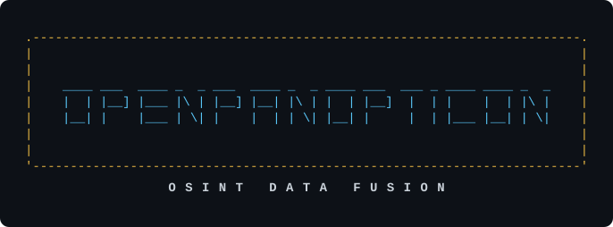
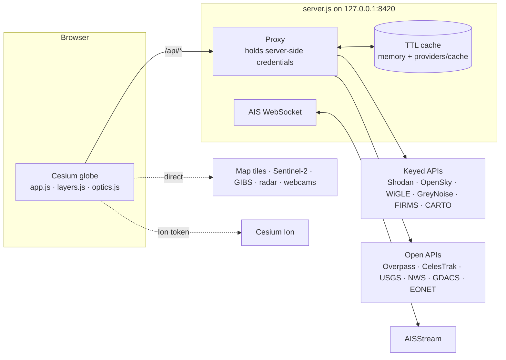

# OpenPanopticon

<div align="center">



[](https://nodejs.org/)
[](LICENSE)
[](package.json)
[](https://cesium.com/platform/cesiumjs/)
[](https://www.youtube.com/watch?v=AVqyvgPxVO8)
[](https://github.com/hexadec-0/OpenPanopticon/actions/workflows/test.yml)

[Run it](#run-it) · [Live demo](https://hexadec-0.github.io/OpenPanopticon/) · [Screenshots](#screenshots-and-demo-video) · [Layers](#whats-on-the-globe) · [Caching](#caching) · [Architecture](#how-its-put-together) · [Responsible use](#using-this-responsibly)

### TRY THE DEMO HERE: <https://hexadec-0.github.io/OpenPanopticon/>

</div>

OpenPanopticon is a geospatial intelligence terminal that runs on your own machine. Point it
anywhere on Earth and it overlays live public data on a 3D globe
(internet-exposed hosts from Shodan, aircraft from OpenSky, satellites
propagated from orbital elements, infrastructure from OpenStreetMap, and
public cameras), then renders the whole thing through emulated sensor optics.

**Contents:**
[Run it](#run-it) ·
[Screenshots](#screenshots-and-demo-video) ·
[What's on the globe](#whats-on-the-globe) ·
[Display](#display) ·
[Altitude gate](#altitude-gate) ·
[Caching](#caching) ·
[When an upstream says no](#when-an-upstream-says-no) ·
[Aircraft and the OpenSky budget](#aircraft-and-the-opensky-budget) ·
[Home](#home) ·
[Base map](#base-map) ·
[Optical modes & Controls](#optical-modes--controls) ·
[How it's put together](#how-its-put-together) ·
[Responsible use](#using-this-responsibly) ·
[Privacy](#privacy) ·
[Terms of service](#terms-of-service) ·
[License](#license)

---

## Run it

Requires **Node 22 or newer** (built-in `fetch` and `WebSocket`). There are
no dependencies to install to run it.

1. **Get the code.**

   ```bash
   git clone https://github.com/hexadec-0/OpenPanopticon
   cd OpenPanopticon
   ```

   From a ZIP download, the folder is `OpenPanopticon-main`.

2. **Create `.env`** from the template:

   ```bash
   cp .env.example .env     # copy on Windows
   ```

   The start scripts also do this on first run if you skip it.

3. **Add your Shodan key.** Open `.env` and set `SHODAN_API_KEY`. It is the
   one key the headline layer needs; everything else is optional (see below).

4. **Start it.**
   - **Linux / macOS**: `./start.sh` (from a ZIP the execute bit may not
     survive, so use `bash start.sh`).
   - **Windows**: double-click `START.bat`.
   - **By hand**: `npm start` (or `node server.js`).

   The scripts check your Node version and open the browser once the server
   answers. Otherwise, open <http://127.0.0.1:8420>.

The globe opens over wherever the machine running it appears to be, resolved
by geoIP (or your pinned home; see [Home](#home)); the `⌂ Home` button returns
there, and the HUD bottom bar shows the resolved city.

**Nothing loading?** Layers only fetch below the altitude ceiling (45 km by
default). Click **FETCH** in the HUD to raise it to 100, 250 or 500 km; higher
ceilings use more API credits. See [Altitude gate](#altitude-gate).

> [!IMPORTANT]
> `SHODAN_API_KEY` is the one key the headline layer needs. Every other key in
> `.env.example` is optional. Some upgrade a layer that already works without
> one (OpenSky, GreyNoise, Cesium Ion); the rest switch on a layer that
> otherwise stays off and says so (AIS, OpenCelliD, WiGLE, Windy,
> OpenWebcamDB, FIRMS, 511, EIA, Cloudflare Radar, CARTO labels). Two more
> are optional and specialised: `EDIS_API_URL` / `EDIS_API_KEY` for a licensed
> RSOE EDIS feed, and a Google service account for an optional Earth Engine
> basemap composite (see `.env.example`).

---

## Screenshots and demo video

**Live demo**: a static, no-install version runs on GitHub Pages at
<https://hexadec-0.github.io/OpenPanopticon/>.

**Demonstration video and tour**

<p align="center">
  <a href="https://www.youtube.com/watch?v=AVqyvgPxVO8">
    
  </a>
  <br />
  <sub><a href="https://www.youtube.com/watch?v=AVqyvgPxVO8">▶ Watch the tour on YouTube</a></sub>
</p>

**Demo images**

<table align="center">
  <tr>
    <td width="50%"><a href="https://github.com/user-attachments/assets/aeedf12d-1f3b-4f8c-87a7-6b51a7cf1ccd"></a></td>
    <td width="50%"><a href="https://github.com/user-attachments/assets/4d1f91c8-02f5-46c3-8c2b-8d899ee0df84"></a></td>
  </tr>
  <tr>
    <td width="50%"><a href="https://github.com/user-attachments/assets/9ad7bd67-ed1e-4b22-83b3-b437590dbe0e"></a></td>
    <td width="50%"><a href="https://github.com/user-attachments/assets/52eb6549-8900-43af-9cd5-71820e843573"></a></td>
  </tr>
  <tr>
    <td width="50%"><a href="https://github.com/user-attachments/assets/5cbf4d94-f7f2-4617-b2be-84a1944034a0"></a></td>
    <td width="50%"><a href="https://github.com/user-attachments/assets/23d9c10a-8ef3-40e5-ade3-98c5ffe8cc23"></a></td>
  </tr>
</table>

<p align="center"><sub>Click any screenshot for full size.</sub></p>

---

## What's on the globe

| Layer | Source | Notes |
|---|---|---|
| **Shodan exposure** | Shodan `host/search` | Every host Shodan has indexed in view, with no filter. Colour by service category (web, remote, database, ICS, camera, network…) or by known CVEs, with a live legend. |
| **Live aircraft** | OpenSky + adsbdb | Positions, callsigns, altitude, heading, vertical rate, motion trails, emergency squawk flagging (7500/7600/7700). Click one to resolve its **departure and destination airports**, airline and airframe. Trails are trimmed to the last two minutes. |
| **Weather** | RainViewer + NASA GIBS | Precipitation radar (RainViewer) and cloud imagery as toggleable globe overlays, with a frame scrubber and animation across the last ~2 hours plus nowcast. Cloud imagery is GOES-East GeoColor from NASA GIBS, which covers the Americas and the Atlantic; see [Overlay resolution limits](#overlay-resolution-limits). |
| **Orbital assets** | CelesTrak | 24 catalogue groups. Real SGP4 propagation in the browser via satellite.js. Click a satellite to draw its ground track for one full revolution. |
| **OSM infrastructure** | Overpass API | 10 toggleable feature classes: surveillance cameras, military sites, comms towers, power plants and substations, airfields, ports, government and diplomatic, emergency services, data centres, fuel storage. |
| **ALPR / Flock** | DeFlock via OpenStreetMap | License-plate readers, coloured by vendor, each drawn with a field-of-view cone from its tagged bearing. Filter by vendor, or to only cameras whose facing is known. |
| **Situational awareness** | GDACS, NASA EONET, USGS, NWS, NASA FIRMS | Live hazard and disaster events for the current view, normalised into one record shape and colour-graded by severity. Red-level events pulse on the globe; events that carry an affected area are drawn as polygons. |
| **Public cameras** | NYC DOT + ALERTCalifornia + Windy + OpenWebcamDB | Click one to watch it live in the side panel: an embedded player where the operator provides one, otherwise the still frame refreshed on a timer. ALERTCalifornia adds ~1,290 wildfire-detection PTZ cameras, keyless. |
| **Vessels (AIS)** | AISStream | Live ship positions, heading, speed, navigation status, destination and dimensions. The server holds the WebSocket; the browser never sees the key. |
| **Network infrastructure** | RIPE Atlas, OpenCelliD, WiGLE, Onionoo | Geolocated network and wireless hardware: measurement probes with ASN, cell towers drawn at their estimated range, WiFi/Bluetooth survey points, and Tor relay capacity by country. |
| **IoT sensors** | Sensor.Community | Citizen-run air-quality and noise hardware with live readings, coloured by WHO PM2.5 bands or measured dB(A). |
| **Traffic (511)** | State DOT 511 feeds | Cameras, incidents, lane closures. Add states to `FIVE_ELEVEN_KEYS`; 24 state hosts are pre-wired. |
| **Satellite imagery** | NASA GIBS | Daily global true-colour, night lights, land-surface temperature and thermal anomalies, scrubbable by date. |
| **Regional signals** | IODA, EIA, Cloudflare Radar, Raspberry Shake | Country- and grid-scale telemetry in the sidebar: internet outages, US electricity demand, Cloudflare outage annotations, citizen seismographs in view. |

### Situational-awareness sources

| Source | Key? | What it adds |
|---|---|---|
| **GDACS** (EU JRC / UN) | no | Global multi-hazard alerts (earthquake, cyclone, flood, volcano, drought, wildfire), graded Green / Orange / Red, 30-day window. |
| **NASA EONET v3** | no | Open natural events: severe storms, wildfires, volcanoes, sea and lake ice. Point *and* polygon geometry. |
| **USGS** | no | Every earthquake reported in the last 24 hours, with depth, felt reports and tsunami flags. Severity from magnitude (≥6 red, ≥4.5 orange). |
| **NWS** | no | US watches, warnings and advisories. Only alerts that carry a polygon are drawn (see [Rate limits](#rate-limits-worth-knowing)). |
| **NASA FIRMS** | free key | VIIRS active-fire detections from the last 48 hours, graded by detection confidence and fire radiative power. |
| **RSOE EDIS** | enterprise | Licensed EDIS feeds are supported via `EDIS_API_URL` / `EDIS_API_KEY`. |

---

## Display

### Labels

`LABELS` in the top bar overlays place and road names from CARTO's
labels-only tileset (OpenStreetMap data). Since 25 September 2026 CARTO
requires a free key: get one at <https://carto.com/basemaps/apikey> and set
`CARTO_API_KEY` in `.env`. The server proxies the tiles, so the key stays out
of the browser. Without a key the button stays off and says so; with one,
labels are on by default.

The labels' own control bar offers light or dark lettering, a contrast
slider, and a **Bold** option that draws the glyphs in two stacked passes:
CARTO's lettering is understated by design for a basemap, and over imagery it
needs the help. Because it is an ordinary tile pyramid the detail scales
itself: motorways and city names when zoomed out, arterials next, then
residential street names as you come in. It matters most with a Cesium Ion
token, where the basemap is photographic imagery with no lettering at all.

### Terrain

Every ground feature is clamped to terrain rather than placed at a fixed
height above the ellipsoid. A constant offset works only where the ground
happens to be at sea level; anywhere higher, pins would sink beneath the
surface and polygons would cut through hillsides.

### Cycle

**CYCLE** selects a random on-screen item on a timer and opens it in the
detail panel: a hands-off way to tour what the current view contains.

### Settings persistence

Which layers were on, how each was filtered, the optical mode, the overlays,
the label styling and the sidebar's state are saved to `localStorage` and
restored on the next load, across a refresh and across a server restart.

It holds UI state only: no credentials, no query results, no positions.
Storage can be unavailable in a private window or when a browser blocks site
data, and a missing store simply means defaults. **Reset saved settings** at
the bottom of the sidebar clears it.

---

## Altitude gate

No view-scoped layer is queried above **45 km** by default (the ceiling is
configurable), so panning around from altitude costs no API calls, Overpass
slots or Shodan credits. Map tiles and imagery overlays still load as normal.

Worth knowing how low that is: at 45 km the view spans only about 40 km, so a
normal "look at the whole city" view sits *above* the ceiling and fetches
nothing new. Click
the **FETCH** cell in the HUD to cycle the ceiling through 45 / 100 / 250 /
500 km; the choice sticks.

While the gate is holding, the FETCH cell reads `HOLD ▲45km` and each layer
shows `↓` with its current altitude. (This is separate from the `AUTO`/`HOLD`
toggle, which pauses automatic refetching at any altitude; see
[Rate limits](#rate-limits-worth-knowing).) Anything already found stays
drawn, and coverage is kept, so descending does not refetch ground already
covered. Layers resume on their own as the camera settles below the ceiling.

Orbital assets are the exception: they are propagated from TLE elements rather
than queried for a view box, and altitude is where you look at them from.

---

## Caching

Retention periods are set in one table near the top of `server.js`. Cached
responses are kept in memory and on disk (`providers/cache/`), so they survive
a restart. Geocoding results are the exception and stay in memory only (see
[Privacy](#privacy)). Files on disk are pruned once they are older than the
longest retention period (72 hours), at startup and every six hours.

Every view-scoped source goes through `viewCell()`, which snaps the requested
box outward onto a fixed grid and hands back both the box to query and the key
to store it under: one function, so the two cannot describe different ground.
The grid never changes size, which is what makes a key name a **region**
rather than a camera position: reloading or nudging the camera lands on the
same cells instead of minting a new entry each time.

The box is built in two steps. The browser pads the view (see
[In the browser](#in-the-browser)), and `viewCell()` then takes the *minimal*
whole-cell cover of that padded box, capped per source (`VIEW_MAX_DEG`, from
0.5° for cell towers and WiFi to 5° for OpenSky). Both limits matter, because
a query far larger than the upstream can answer does not degrade; it hangs.
Ten Overpass feature classes over several degrees run past every mirror's
timeout and the layer shows nothing at all, so a very wide view is answered
for its centre and the response says `trimmed` so the UI can admit it. Cell
sizes are per-source: coarse where the upstream is generous and the features
sparse, fine for Overpass (cost scales with area) and for sources that cap
their results, since over-wide queries would let the cap start truncating real
features.

Holding one key across a whole zoom band is the tempting alternative, and it
is a trap: it means querying a box sized for the widest zoom in the band. The
reuse comes from the other end instead: the response reports the cell it
covered, the browser records *that* rather than what it asked for, and every
view inside the cell is then answered locally with no request at all. Closing
in on a city across ten zoom steps costs one Overpass call.

Classes are sorted not by importance but by how an answer goes wrong as it ages:

| Class | Held | What |
|---|---|---|
| `static` | **72 hours** | Where fixed things are: OSM infrastructure, ALPR and webcam directories, Shodan hosts, cell and WiFi, Tor relays, seismometer stations, geocoding (memory only), airframes. |
| `orbit` | 24 hours | Orbital elements. |
| `hazard` | 1 hour | Present-tense claims: active alerts and hazards, traffic incidents, outages, live sensor readings. |
| `schedule` | 30 minutes | Flight schedules (see below). |
| `live` | 4 minutes | Radar frame index. Aircraft and vessels use their feed's own rate. |
| `account` | 1 minute | Credit balances, shown as a number in the UI. |

An inventory of fixed things is still true in three days, so holding it longer
costs nothing and saves every API budget here. A present-tense claim is
different: an alert has an expiry, a fire perimeter moves, an air-quality
reading is about now. Those do not go stale so much as become false, and a false
reading presented as current is worse than none. That is why two kinds of data
are kept short or not kept at all:

- **Live positions** aren't cached on the server: aircraft follow OpenSky's
  5 s or 10 s cadence and vessels arrive over the AIS stream. The browser keeps
  the last two minutes as trails. Only the radar frame index is held, for
  4 minutes (`live`).
- **Warnings and alerts** (NWS, USGS, GDACS, EONET, FIRMS, EDIS, IODA, and
  traffic incidents) are held for 1 hour (`hazard`). A tornado warning from
  yesterday drawn as current is worse than the API call it saved.

Orbital elements sit between the two for a reason of their own: an orbit is
perturbed continuously and CelesTrak republishes every two hours, so
propagating three-day-old elements would put a low-orbit object tens of
kilometres from where it is, and the pin would still be drawn, confidently,
in the wrong place.

Flight schedules need the most care. A callsign is a service on a given day,
not a permanent city pair; the same flight number flies different legs on
different days, often the reverse leg the next. Keyed on the callsign alone
and held for long, a lookup would confidently return yesterday's route for
today's aircraft. So schedules are keyed by callsign *and* UTC date, kept for
30 minutes, and **looked up live whenever you click a flight**: the pick
writes through the cache, so it also corrects whatever was stored. The
airframe beside it is keyed by the aircraft's own hex, does not change, and is
still served from cache.

If the aircraft's position contradicts the schedule (descending over New York
on a route ending in San Jose), the panel says so rather than presenting it as
fact.

### In the browser

Redrawing purely from the latest response would make everything outside the
new box vanish the moment you pan or zoom out, so layers keep a client-side
feature cache as well:

- Features accumulate as you move, so earlier dots stay on the globe until evicted (LRU, 4,000 per layer, 1-hour TTL).
- Views already inside a recent fetch repaint from cache with **no network call**, which is what stops panning around from burning Shodan query credits.
- Fetches pad the view before asking (30% by default, 15–60% depending on the layer), so small pans stay inside the covered region.
- Changing something that alters the *query* (Overpass classes, event sources) drops the cache, so results fetched under different criteria can never merge together.
- Changing something **display-only** (colour mode, ALPR vendor chips, indoor sensors, cone rendering) repaints from cache instantly and costs nothing.

**SYNC** (or `R`) forces a refresh past every tier, memory and disk. **FLUSH**
additionally empties the browser's feature cache and the server's stored
responses, then refetches.

---

## When an upstream says no

Every layer backs off on **any** failure (a dead Overpass mirror, an
exhausted credit bucket, an IP ban, a timeout, a malformed response) on a
fixed ladder:

```
30 s → 60 s → 90 s → 120 s → 300 s → hourly (repeating)
```

The point is not politeness. A layer that retried on its own normal schedule
after a failure would ask *most* often precisely when the upstream could least
afford it: the live poll every few seconds, the camera-settle refetch on every
pan. Backing off turns a struggling mirror or a banned address into something
the terminal rides out quietly instead of making worse.

Details that matter:

- **Where the upstream states a wait, it wins if it is longer.** OpenSky
  reports it in `X-Rate-Limit-Retry-After-Seconds` (not the standard
  `Retry-After`), and both the server and the browser honour it; being told
  137 s and returning after 30 s is not a retry, it is ignoring the answer.
- **Nothing gets through while it is waiting.** The poll and the pan refetch
  are both gated, and skipped attempts do not advance the ladder; only real
  attempts count.
- **Deliberate acts start over.** SYNC, switching a layer off and on, or
  changing what it asks for all reset to the first step and go out
  immediately. A filter change is a different question and is owed a fresh
  attempt, which is why the settings check runs *before* the backoff gate.
- **A retry refetches rather than replaying.** An hour-long step easily
  outlasts the view it was scheduled under, so the retry re-enters through the
  app: current camera position, altitude gate applied again.
- **Success clears it**, so a later failure starts from 30 s rather than
  resuming where it left off.

The layer's count cell shows the wait (`45s`, `5m`, `1h`) and ticks down, and
the tooltip names the attempt and says when it has settled at hourly. A layer
being patient is styled apart from one that is simply dead.

---

## Aircraft and the OpenSky budget

OpenSky's allowance is a daily bucket, not a rate: 400 credits anonymous (per
IP), 4,000 authenticated (set `OPENSKY_CLIENT_ID` and `OPENSKY_CLIENT_SECRET`),
8,000 for active feeders, refilled at 00:00 UTC. A `/states/all` call inside
25 square degrees costs one credit. The arithmetic is unforgiving: a poll
every 6 s is 600 calls an hour, so a 4,000-credit day is spent in under seven hours
of having the map open, and then the layer is dead until the next UTC day.

So the poll interval is derived rather than fixed. Every response carries
`X-Rate-Limit-Remaining`, and the server spreads what is left over the time
until the next refill, with the feed's own resolution as the floor (polling
faster than OpenSky publishes only returns the same positions) and five
minutes as the ceiling. A fresh authenticated bucket at the start of a UTC
day works out around 20 s; if you have barely used it, the interval
shortens as midnight approaches. The layer's tooltip shows the interval, the
credits left, and says when it has slowed down and why. **SYNC always forces
a lookup**, whatever the budget.

Two other things keep the bill down:

- The queried box is snapped outward to a 1° grid, which takes it to at most
  5×5°: exactly the edge of the one-credit band. Since OpenSky charges per
  call and not per area, a generous box costs the same as a tight one and
  returns more, and panning around a city reuses one answer instead of
  spending a credit per nudge.
- Polling stops while the browser tab is hidden, and refreshes once on return.
  Otherwise a terminal left open in a background tab would spend the day's
  budget on frames nobody sees.

A 429 is handled like any other failure; see
[When an upstream says no](#when-an-upstream-says-no).

`OPENSKY_CREDIT_FLOOR` (default 60) is the reserve held back from automatic
polling, so a deliberate look still works after a long day.

---

## Home

Home is where the terminal opens and where the ⌂ button flies. To set one,
press **⋯** next to it in the sidebar's *Saved targets* section.

- **Geolocate host and save as home**: asks the server where this machine is
  (ipwho.is, by public address) and pins the answer. It bypasses the server's
  30-minute geoIP cache, because the point of pressing it is to find out where
  the host is now.
- **Use current view**: pins wherever the camera is, at the altitude it is
  at. To pin anywhere at all, fly there first (search, or drag the globe) and
  press it. Pinning a city and pinning a rooftop are different pins.
- **Lat / Lon**: type coordinates directly. Name is optional and is what the
  HUD shows; without one it falls back to the coordinates.
- **Clear**: forget the pin and go back to resolving the host each session.

With nothing pinned, it resolves the host on boot and falls back to Austin if
that fails. That resolved location is *not* saved, which is the distinction
worth knowing: a laptop that changes networks should open over where it is
now, not where it was last week. Pinning is what the geolocate button is for.
A pinned home lives in this browser's local storage and is never sent
anywhere.

---

## Base map

The ground layer under everything else. You always choose the source by name
in the **BASEMAP** menu, and it is credited in the bottom-left corner,
including, for Sentinel-2, the date of the scene you are looking at.

- **Streets (OpenStreetMap)**: the default with no Cesium Ion token.
- **Aerial (Cesium World Imagery)**: the default *when* `CESIUM_ION_TOKEN` is
  set, since that is what Cesium draws from an Ion session. High resolution,
  but it is a mosaic of many surveys and a given place can be years out of
  date. If somewhere looks old, this is why; switch to Sentinel-2 to see a
  picture with a date on it.
- **Sentinel-2 (10 m)**: recent Copernicus imagery, no key needed. Pick a
  date window and cloud-cover ceiling; the scene list refreshes for whatever
  is in view when the camera settles.
- **Shortbread (OSM vector)**: OpenStreetMap drawn in the terminal's own
  palette, from VersaTiles by default. Override the tile source with `SHORTBREAD_URL`.

Hover **BASEMAP** in the top bar for the controls. Imagery tiles are fetched
by the browser directly rather than proxied: they are megabytes per screen,
and relaying them would add a hop for nothing.

---

## Optical modes & Controls

Each is a real GLSL post-process pass over the rendered scene, not a CSS filter.
Press `1`–`5`.

- **EO**: unfiltered.
- **FLIR**: thermal ironbow ramp with a crude automatic gain control that stretches local contrast, plus sensor noise and fixed-pattern banding.
- **SAR** (synthetic aperture radar): Sobel-driven backscatter, multiplicative speckle, range lines.
- **CRT**: barrel distortion, misconverged guns, aperture grille, rolling refresh bar.
- **CEL**: posterised and ink-outlined, because surveillance aesthetics don't have to be grim.

`R` re-syncs every layer, `H` hides all chrome for a clean screenshot, `[`
collapses the sidebar to the left edge, `Esc` closes the detail panel.

---

## How it's put together

```
start.sh             launcher for Linux and macOS
START.bat            launcher for Windows
.env.example         template for .env: every key and setting, commented
server.js            zero-dependency Node proxy; holds every server-side
                     credential, normalises 30-plus upstream APIs, holds the
                     AIS WebSocket, TTL cache + in-flight dedupe
public/
  index.html         chrome and HUD
  style.css
  js/app.js          viewer bootstrap, refresh loop, HUD, panel wiring
  js/layers.js       one class per source; each owns a Cesium DataSource
  js/optics.js       the sensor shaders
  js/mvt.js          minimal Mapbox Vector Tile decoder
  js/shortbread.js   draws Shortbread tiles to canvas in the terminal palette
  js/inset.js        the close-up map in the detail panel
  js/selection.js    the ring around the current pick
  js/autocycle.js    CYCLE: selects a random on-screen item on a timer
  js/settings.js     saved UI state (localStorage)
  providers/         third-party code shipped with the app: satellite.js
                     (MIT, bundled) and its license
providers/           runtime data written by the server, never committed:
                     response cache, downloaded TLE copies, diagnostics
package.json         Node engine, scripts. No runtime dependencies
test/                the test suite (see test/README.md)
demo/                static GitHub Pages demo (see demo/README.md;
                     live at https://hexadec-0.github.io/OpenPanopticon/)
docs/                the built demo, once captured (served by GitHub Pages)
LICENSE              GPL-3.0-or-later
```

Note the two `providers/` folders: `public/providers/` is bundled library
code served to the browser, while the top-level `providers/` is the server's
own runtime data.

### Adding a data source

Each source is a normalising function and route in `server.js` plus a layer
class in `public/js/layers.js`, with a fixture and functional test under `test/`.
[`providers/README.md`](providers/README.md) walks through the steps, using
the Sensor.Community layer as a template.



Every keyed upstream request goes through the server, which attaches the
credential on the way out; the credentials for Shodan, OpenSky, WiGLE, CARTO
and the rest never reach the browser. The one exception is the **Cesium Ion token**: Cesium
streams terrain and imagery from the browser by design, so `/api/config` hands
it over. Treat it as public and scope it in your Cesium Ion account to
read-only access on the assets you use.

Layers refresh from the camera's own view rectangle, debounced 700 ms after
the camera settles. The browser caps the view span at 4° so a zoomed-out globe
doesn't ask Shodan for the entire planet, and each source then applies its own
cap (see [Caching](#caching)). The aircraft poll interval is derived from the
feed and the remaining OpenSky credits (see
[Aircraft and the OpenSky budget](#aircraft-and-the-opensky-budget));
satellites re-propagate every frame; server-side retention follows the table
under [Caching](#caching).

### Rate limits worth knowing

- **Shodan**: every search carries a `geo:` filter, so each one costs a query credit. Results are fetched per fixed grid cell and reused, so panning inside a cell you have already paid for is free; each new cell is one credit. To pause automatic refetching while you explore, switch the `AUTO` toggle in the top bar to `HOLD`, then press `SYNC` when you've framed the shot.
- **OpenSky**: a daily credit bucket, not a rate; see [Aircraft and the OpenSky budget](#aircraft-and-the-opensky-budget).
- **NWS**: about 85% of active alerts reference forecast zones instead of carrying a polygon. Resolving each zone would be hundreds of extra requests, so those are counted in the layer note but not drawn. The layer says how many.
- **OpenWebcamDB**: free for non-commercial use only, and the documented list route has no spatial filter, so the whole catalogue (~1,500 cameras) is paged once and cached (`static`, 72 hours), then filtered locally.
- **Overpass**: a donated, shared service with roughly two execution slots per IP. Every selected feature class goes out as **one** unioned query, not one query per class, and all Overpass-backed layers (infrastructure and ALPR) share a single serial queue with a minimum gap between requests. On a 429 the three mirrors rotate, then a cooldown applies and the layer schedules its own retry, and the sidebar shows the countdown rather than just failing.
- **Nominatim**: 1 request/second; searches are debounced and cached in memory for 72 hours (`static`), never on disk.

---

## Using this responsibly

> [!WARNING]
> Everything here reads public data through documented APIs. That does not make
> every use of it legal or wise.
>
> - Mapping ALPR cameras is generally lawful transparency work: they sit in public, photographing public roads, and organisations from the EFF to local journalists do exactly this. Interfering with one is a different act entirely: damaging or obstructing police equipment is a crime, and this tool exists to document the surveillance layer, not to help anyone attack it.
> - The geoIP lookup resolves the location of whatever public IP this machine presents. It's city-level at best, often wrong on mobile and VPN connections, and the server never sends your IP to the browser.
> - WiGLE and OpenCelliD are wireless-survey databases. Mapping infrastructure is their purpose and it's ordinary research; using them to work out where a particular person's device has been is a different activity with a different ethical and legal profile.
> - Shodan tells you a host answers on a port. It does not authorise you to connect to it. Remote-desktop hosts (RDP, VNC) in particular may be one click from someone else's screen: look, do not touch. Scanning, logging in, or "just checking if the default password works" against infrastructure you don't own is a crime in most jurisdictions regardless of how the host was found.
> - The camera layer shows cameras their operators publish for public viewing: traffic cams (NYC DOT, 511), Windy's scenic cams, ALERTCalifornia's wildfire cameras, and OpenWebcamDB's hand-curated directory. The camera layer deliberately does not surface unsecured private cameras, and adding that would be both a privacy violation and, in many places, illegal. The Shodan layer is different: it can include unsecured devices, cameras among them, and the same look-don't-touch rule applies.
> - Hazard feeds are for situational awareness, not for life-safety decisions. GDACS and EONET are coordination tools with real latency, and this app caches on top of that. In an actual emergency, follow your local official warning channel.
> - OSM feature data is contributed by volunteers and is frequently incomplete or stale. Absence of a marker means nothing.
> - Aircraft and satellite positions are hobbyist-grade. Don't navigate with them.

Good uses: mapping your own organisation's external attack surface, security
research and teaching, journalism, understanding what your city already
publishes about itself. Attack-surface work on someone else's network needs
their written authorisation first.

---

## Privacy

OpenPanopticon has no hosted service; everything runs on your machine, but it
is not anonymous:

- **The server queries every upstream from your IP address.** Each source sees
  your address and the area you are looking at.
- **Some content loads directly in the browser**, not through the server: map
  tiles (OpenStreetMap, VersaTiles, and Esri aerial imagery in the close-up
  inset), imagery overlays (Sentinel-2 via TiTiler, NASA GIBS, RainViewer),
  webcam images and players, aircraft photos (adsbdb thumbnails), and Cesium Ion
  terrain and imagery if configured.
  CARTO labels are proxied through the server.
- **`/api/geoip`** sends this machine's public IP to `ipwho.is` to find the
  home location. The answer is held in memory for 30 minutes (the geolocate
  button bypasses that) and is never written to disk.
- **Keyed queries are tied to your accounts.** Shodan, WiGLE, GreyNoise and
  the other keyed services log what your key searched for.
- **Cached answers on disk show where you looked.** `providers/cache/` holds
  upstream responses for the areas you viewed, for up to 72 hours. The server
  deletes older files at startup and every six hours, and **FLUSH** deletes
  them all. Cache keys are stored only as hashes, so a custom Shodan query is
  not written in clear (its results still are). Place-name searches are never
  written to disk; they are cached in memory for the session only.

---

## Terms of service

> [!NOTE]
> Several upstreams restrict redistribution and automated or bulk use, Shodan
> and WiGLE in particular, and OpenSky and OpenWebcamDB are non-commercial
> only. Running this for yourself with your own keys is the intended use.
> **Hosting it for other people** (sharing your keys, or republishing what it
> returns) can breach those terms. Read each provider's terms before you do.

---

## License

This code is licensed under the GNU General Public License v3.0 or later
(GPL-3.0-or-later); see `LICENSE`. `public/providers/satellite.min.js` is
bundled third-party code and remains under its own MIT license
(`public/providers/satellite.LICENSE`). Upstream data carries its own terms:
Shodan's API terms, OpenSky's non-commercial license, OpenStreetMap's ODbL
(attribution required if you republish), CelesTrak's terms, Windy's API terms,
OpenWebcamDB's non-commercial-only terms, and the NASA/USGS/NOAA feeds (US
public domain, attribution appreciated). GDACS data is published by the
European Commission JRC under its own reuse terms.
